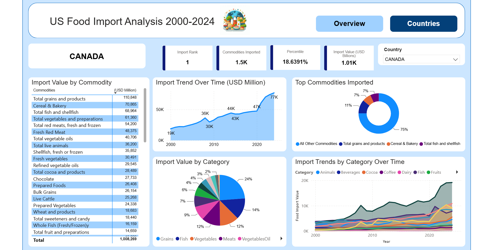

# US Food Import Analysis (2000–2024)

Where does America's food come from, and how has that changed? This project analyzes 25 years of U.S. food import data from the USDA Economic Research Service, covering 58 supplier countries. The data is prepared in Excel, modeled in SQL Server, and visualized in an interactive two-page Power BI dashboard (Overview and Countries).

[](https://app.powerbi.com/view?r=eyJrIjoiNDA4MTZmMzItNDE2YS00YmE3LWJhMGMtZjY0OGE3NTg3MjY2IiwidCI6ImJjNGQ5MjI5LTgwODktNGE3Zi1iZjQwLTA0NTk0MDFlOWVkMiIsImMiOjJ9)

**[View the live Power BI dashboard](https://app.powerbi.com/view?r=eyJrIjoiNDA4MTZmMzItNDE2YS00YmE3LWJhMGMtZjY0OGE3NTg3MjY2IiwidCI6ImJjNGQ5MjI5LTgwODktNGE3Zi1iZjQwLTA0NTk0MDFlOWVkMiIsImMiOjJ9)** (click the image or this link)

**[Watch the project walkthrough (Loom)](https://www.loom.com/share/045b0c2572cc45e09a424acfddb2ff74)**

## Key Findings

- **Canada is the #1 named supplier of U.S. food imports**, accounting for about 18.6% of the total since 2000.
- **Imports from Canada roughly quadrupled**, from about $19B in 2000 to about $77B in 2024, with the sharpest jump after 2020.
- **Grains and cereal & bakery products lead Canada's exports to the U.S.**, with grains alone making up about 24% of the value.
- **A handful of countries dominate**: the top 10 suppliers account for most U.S. food import value, and the dashboard shows which country leads each commodity.

## Tools

| Stage | Tool |
|---|---|
| Data preparation | Excel |
| Data modeling & analysis | SQL Server (SSMS): CTEs, window functions (`RANK`, `DENSE_RANK`), views |
| Visualization | Power BI (2 pages, country slicer, drilldowns) |

## Pipeline

```
USDA ERS (Excel)  →  Excel (reshape + clean)  →  SQL Server (FoodImports table + views)  →  Power BI
```

1. **Prepare:** downloaded the USDA ERS food import tables and reshaped them in Excel into one long table (country, commodity, category, year, value).
2. **Model:** loaded the table into SQL Server as `dbo.FoodImports` and built views to answer specific questions: country rankings and shares, top commodities per country, which country dominates each commodity, category mix, and trends over time.
3. **Visualize:** Power BI connects to the views for the Overview and Countries pages.

## Repository Contents

| Folder / File | What's inside |
|---|---|
| `sql/01_country_views.sql` | Country rankings, market share, top 10 suppliers, KPIs |
| `sql/02_commodity_category_views.sql` | Commodity breakdowns, top 3 per country, dominant supplier per commodity, category mix |
| `sql/03_trend_growth_views.sql` | Yearly trends, category trends, 5-year growth |
| `screenshots/` | Dashboard images |
| `data/` | Data source info |

## Data Source

U.S. Department of Agriculture, Economic Research Service: [U.S. Food Imports](https://www.ers.usda.gov/data-products/us-food-imports)

Values are in USD millions, nominal (not adjusted for inflation).

## How to Run

1. Download the U.S. Food Imports Excel files from the link above.
2. Reshape the data into one table with columns `Country`, `Commodity`, `Category`, `YearNum`, `FoodValue`.
3. Import it into a SQL Server database named `US_Food_Import` as `dbo.FoodImports`.
4. Run the files in `sql/` in order.
5. Connect Power BI to the database and use the views.

## Author

**Carl D. Pericles**: Marine Corps veteran and data analytics student (B.A.S., Data Analytics & AI, Broward College)
[LinkedIn](https://www.linkedin.com/in/carlpericles) · [GitHub](https://github.com/CarlPericles18)
